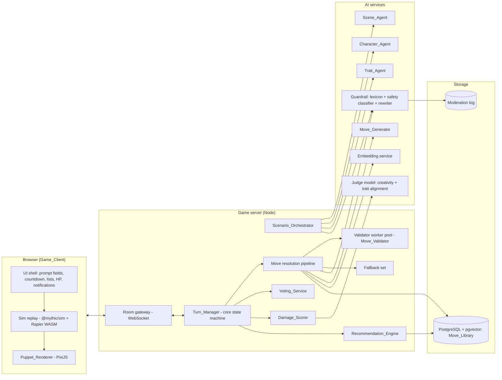
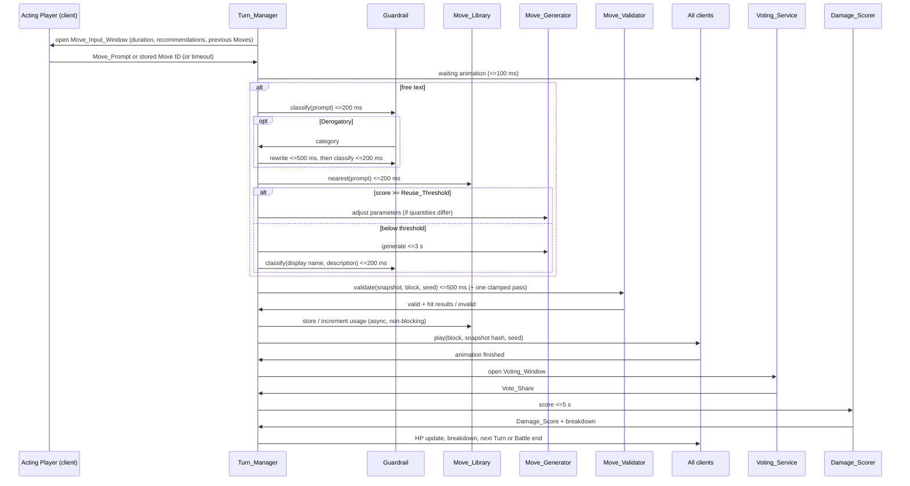
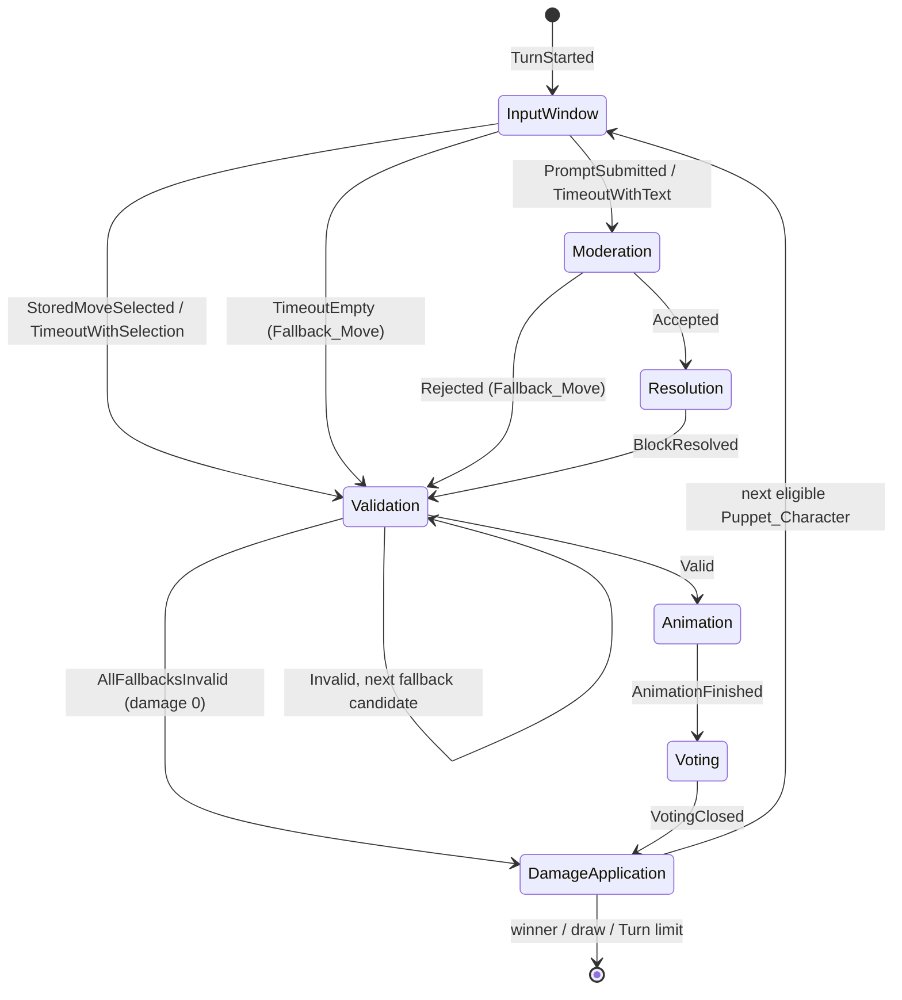

# Design Document: Mythic Strings Shadow Puppet Battle

## Overview

Mythic Strings is a browser-based 2D turn-based fighting game in the visual style of Tholu Bommalata. A Player types a matchup, a multi-agent AI pipeline builds a Scenario, and each Turn the acting Player types a free-text Move that becomes a Move_Block: a JSON document listing registered physics primitives with parameters. A server-side, headless, deterministic physics simulation validates every Move_Block and computes hit results. The browser then replays the same simulation from the same state and seed, so what the Player sees matches what was scored.

The design has three layers:

1. **Pure core logic** (`@mythic/core`): Move_Block schema, parser, printer, Turn state machine, damage formula, trait validation, vote tallying, library tie-breaking, fallback selection, and recommendation ranking. All of it is deterministic TypeScript with no I/O, which makes it the main target for property-based tests.
2. **Simulation** (`@mythic/sim`): ragdoll construction, Move_Primitive implementations, and the Move_Validator, built on the cross-platform deterministic build of Rapier2D. The same package runs in Node worker threads (validation) and in the browser (animation replay).
3. **Services and client**: an authoritative game server that runs Turns, AI adapters (Scenario agents, Move_Generator, Damage_Scorer judgement, Guardrail), the Move_Library on PostgreSQL with pgvector, and a PixiJS client that renders the shadow-puppet stage.

### Key design decisions

| Decision | Choice | Rationale |
|---|---|---|
| Language | TypeScript end to end (Node 22 LTS server, browser client) | One language lets the parser, schema, damage formula, and physics code be shared byte-for-byte between server validation and client replay, which Req 11.9 and 11.10 depend on. |
| Physics engine | `@dimforge/rapier2d-deterministic` (Rapier, Apache-2.0, WASM) | See "Physics engine selection" below. |
| Rendering | PixiJS v8 (WebGL2, WebGPU when available) | Mature 2D renderer with blend modes, masks, and polygon meshes. The multiply blend mode gives the overlap-darkening required by Req 1.3. |
| Server transport | Fastify + `ws` WebSockets, one authoritative room process per Battle | Turn-based play needs low message volume but server authority over timers, moderation, and Health_Points. |
| Move_Library store | PostgreSQL 16 + pgvector (HNSW index, cosine distance) | Gives transactional inserts (Req 14.10: no partial entries), unique constraints for idempotent storage (Req 14.6), and vector search in one store. |
| Guardrail | Two stages: local lexicon filter, then a self-hosted small safety classifier (Llama Guard 3 1B, or NVIDIA Nemotron Safety Guard via NIM when GPU capacity allows) | The 200 ms budget (Req 10.1) rules out large hosted LLM round trips. Both models return safety labels plus violated categories, which map to the six required categories. |
| LLM agents | Provider-agnostic adapter with JSON-schema structured output | Model choice is an open decision. Structured output reduces schema-invalid Move_Blocks, and the parser still enforces the schema (Req 9.8). |
| Serialization | Canonical JSON (sorted keys, no insignificant whitespace, normalized numbers) | Needed for deterministic printing (Req 13.7) and for equivalence checks in the library (Req 14.6). |
| Test framework | Vitest + fast-check | fast-check is the standard PBT library for TypeScript. |

### Physics engine selection

The user suggested NVIDIA PhysX. PhysX is a 3D engine; it can be constrained to a plane but has no first-class 2D ragdoll API and no official browser build, so it is a poor fit. The realistic open-source 2D candidates are:

| Engine | Determinism | Browser | Notes |
|---|---|---|---|
| Rapier2D (`rapier2d-deterministic`) | Cross-platform deterministic build (same results across OS and CPU) per the [Rapier determinism guide](https://rapier.rs/docs/user_guides/rust/determinism/) and the [npm package notes](https://www.npmjs.com/package/@dimforge/rapier2d) | Official WASM/TypeScript bindings | Joint limits and motors, world snapshot/restore, continuous collision. The deterministic build is slower than the default build. |
| Box2D v3.1 | Cross-platform determinism verified in CI across compilers and x64/ARM, per the [Box2D determinism post](https://box2d.org/posts/2024/08/determinism/) | No official JS binding; community WASM ports only | Excellent ragdoll behaviour. Determinism depends on recreating the world in the same body order. |
| Planck.js (Box2D 2.x port) | Same-machine determinism only; JS floating point across engines is not guaranteed | Native JS | Easy to use, but no cross-platform guarantee. |

**Choice: Rapier2D deterministic build.** It is the only option with an officially maintained browser binding and a documented cross-platform determinism guarantee, which covers both headless validation in Node (Req 11.1, 11.8) and identical client replay (Req 11.9, 11.10). Its world snapshot API lets the validator restore the exact live state into a scratch world without touching the live world (Req 11.8). The performance cost of the deterministic build is acceptable because a scene holds at most a few hundred bodies (Req 11.4 caps spawned bodies at 200).

Known risk: Rapier issue [#797](https://github.com/dimforge/rapier/issues/797) reports lost determinism when setting rotations on attached colliders. The sim package must never mutate collider transforms directly after creation; a determinism property test (Property 13) guards against this class of bug.

### Assumptions and open decisions

The user did not specify the following. The design states an assumption for each so work can proceed; each one can change without affecting the core logic layer.

| Topic | Assumption | Alternatives |
|---|---|---|
| Target platform | Desktop web browsers (latest Chrome, Edge, Firefox, Safari). Minimum supported hardware: 4-core laptop CPU from 2018 with integrated GPU (Intel UHD 620 class), 8 GB RAM. | Electron/Tauri desktop wrapper; mobile later. |
| Multiplayer | Online play: 2 to 4 Players in one room over WebSockets, authoritative server. Local hot-seat is supported by letting one browser control several Puppet_Characters. | Peer-to-peer with lockstep; local-only. |
| Accounts | Anonymous guest identity (server-issued UUID stored in a signed cookie). Used as the Player identifier in Move_Library entries (Req 14.1) and to separate Players from Spectators (Req 16.5). | OAuth login. |
| Spectators | Join via a room link; one vote per Move per Spectator identity. Vote-stuffing through many guest identities is accepted risk for the first release. | Logged-in voting only. |
| Number of opponents | Each Move has one primary target Puppet_Character, chosen by the Move_Block target rules. Damage_Score applies to that target only (Req 15.8 is singular). Physics contacts on other characters are simulated but do not deal damage. | Splash damage per target. |
| LLM provider | Any provider with JSON-schema structured output and p95 latency under 2.5 s for ~1 k output tokens. | Self-hosted open-weight model. |
| Embedding model | A sentence embedding model producing normalized vectors (for example a 384- or 768-dimension model), self-hosted for latency. | Hosted embedding API. |
| Moderation log retention | 90 days, access restricted to operators. | Per policy. |

## Architecture



### Process layout

- **Room process**: each Battle is one in-memory room object on the game server. It owns the Turn_Manager state, timers, and the authoritative live physics world snapshot. Rooms are pinned to one server instance (sticky routing by room ID).
- **Validator worker pool**: `piscina` worker threads, each with its own Rapier WASM instance. A validation job receives a world snapshot, a Move_Block, and a seed, and returns hit results. Running in a worker lets the room enforce the 500 ms limit by terminating the job (Req 11.3) and guarantees the live world is never touched (Req 11.8).
- **AI services**: called over HTTP with per-call deadlines implemented with `AbortController`. Every deadline in the requirements maps to one timeout constant in `@mythic/core/config`.

### Turn flow



### Turn phase state machine

The Turn_Manager is a pure reducer `(BattleState, Event) -> (BattleState, Effect[])` in `@mythic/core`. The room process executes the effects (timers, service calls) and feeds results back as events. This keeps all ordering and invariant logic testable without I/O.



The `phase` field has exactly one value at a time and transitions follow only the edges above, which enforces Req 6.3. When voting is disabled, the Voting phase completes immediately with Vote_Share 0.5 (Req 16.9). A stored-Move selection skips Moderation and Resolution because stored Move_Blocks were already moderated when stored (Req 10.8); Req 6.3 is still satisfied because those phases complete as no-ops in order.

## Components and Interfaces

All interfaces are TypeScript. `Result<T, E>` is `{ ok: true; value: T } | { ok: false; error: E }`.

### Package layout

```
packages/
  core/      pure logic: schema, parser, printer, turn reducer, scoring, voting, library rules, config
  sim/       Rapier ragdolls, Move_Primitive implementations, Move_Validator
  server/    room gateway, effect executor, AI adapters, Postgres repositories
  client/    PixiJS renderer, UI shell, sim replay
  content/   fallback Move_Blocks, default humanoid rig, lexicon lists, prompt templates
```

### Game_Client (`packages/client`)

- **Scenario screen**: Scenario_Prompt text field. Trims input and checks 1 to 500 characters before sending (Req 3.1, 3.3). Disables submit while classification is pending (Req 3.7). Shows one status chip per agent with values `pending | in_progress | complete | failed` from server push events (Req 4.7). Shows Traits, magnitudes, and Health_Points per Puppet_Character (Req 5.4) and per-element regenerate buttons (Req 4.9).
- **Move_Input_Window panel**: countdown computed as `ceil(remainingMs / 1000)`, refreshed by a 250 ms ticker from a server-provided deadline (Req 7.2). `maxlength=200` on the field (Req 7.3). Recommended list and previous-Moves list. Recommendations refresh on keystroke with a 150 ms debounce so the server has the remaining ~150 ms of the 300 ms budget (Req 8.5). The server owns the deadline; when it closes the window, the client disables input (Req 7.9) and any late message is rejected by the reducer (Req 6.5).
- **Notifications**: substitution notices (Req 10.6, 17.5), generator notes (Req 9.7), damage breakdown (Req 15.4), fallback-scorer notice (Req 15.10). Visibility durations are enforced by a notification queue with a `minVisibleMs` per item.
- **Spectator view**: same stage, vote buttons, voting countdown (Req 16.4). Original rejected Move_Prompts are never sent to non-acting clients (Req 10.11); the server sends them only on the acting Player's socket.

### Puppet_Renderer (`packages/client/render`)

- **Stage backlight**: a full-screen warm radial gradient (oil-lamp look) on the bottom layer, with slight flicker driven by the Battle seed.
- **Segments**: each segment is a PixiJS `Mesh` built from its outline polygon (triangulated with earcut, which supports holes). Fill color from the Character_Agent palette, `alpha` clamped to [0.3, 0.9] (Req 1.1, 1.6). Segments use `blendMode = 'multiply'`. Multiplying any color with alpha below 1 over the lit background darkens it, and two overlapping multiplied segments are darker than either alone (Req 1.3).
- **Perforations**: holes in the triangulated polygon, so the backlight shows through at full brightness (Req 1.4). Ornaments are line patterns drawn at their specified segment-local positions.
- **Pivot markers**: small rivet circles drawn on a top layer at each joint's world position every frame, culled only when off the visible Stage (Req 1.2).
- **Fallback rendering**: `buildSegmentGeometry(segment)` returns the plain outline when perforation data is absent or fails validation (self-intersecting hole, hole outside outline, triangulation failure). The segment's shape and joints are unchanged (Req 1.5).
- **Performance**: segment meshes are built once per Puppet_Character. Per frame, only transforms update. Effects (projectiles, clones) use a pooled set of meshes. Target: 30 FPS average, no frame over 100 ms with 4 characters and 200 effect bodies (Req 1.7). A Playwright benchmark on reference hardware measures this.

### Physics_Engine wrapper (`packages/sim`)

```ts
interface RigSpec {            // from Character_Agent, validated
  segments: SegmentSpec[];     // 6..20 rigid bodies
  joints: JointSpec[];         // revolute joints with lowerRad <= upperRad
}

function validateRig(rig: unknown): Result<RigSpec, RigError>;
function resolveRig(rig: unknown): RigSpec;   // validated rig, or DEFAULT_HUMANOID_RIG (Req 2.6)

class SimWorld {
  static create(stage: StageSpec, characters: CharacterRuntime[], seed: number): SimWorld;
  static fromSnapshot(bytes: Uint8Array): SimWorld;
  snapshot(): Uint8Array;
  step(): StepReport;                     // fixed dt = 1/60 s
  setStandingMotors(characterId: string, enabled: boolean): void;
  releaseMotors(characterId: string): void;
  jointAngles(characterId: string): JointAngle[];
}
```

- **Ragdolls**: one dynamic rigid body per segment, revolute joints with limits enabled. Rapier joint limits are soft at the solver level, so after each step the wrapper checks every joint angle; if an angle exceeds its limit by more than 1 degree, it applies a corrective angular velocity on the next step. Property tests check the 2-degree tolerance (Req 2.4, 2.8). Joints are never removed, so segments cannot detach.
- **Standing controller**: when the character has HP > 0 and no Move animation is playing, PD joint motors target a rest pose and a torso-uprighting torque is applied. Reaching the standing pose within 2 s (Req 2.3) is checked by a simulation test across random knock-down states.
- **Defeat**: when HP becomes 0, `releaseMotors` runs in the same step and a `defeated` flag prevents re-enabling until the Battle ends (Req 2.5, 2.7).
- **Contacts**: collision event handlers record, per step, which collider touched which segment and the contact impulse. Forces from primitives apply only to the bodies listed in their target set (Req 2.2).
- **Determinism rules**: fixed timestep; bodies and colliders created in a canonical order (characters by Scenario order, segments by index, then effect bodies by primitive index and spawn index); all randomness from a seeded PRNG (`pure-rand` xoroshiro128+) passed to primitives; no `Math.random`, no wall-clock reads inside the step loop; no direct collider transform mutation after creation.

### Move_Primitive registry (`packages/sim/primitives`)

```ts
interface MovePrimitive<P> {
  name: string;                       // unique, snake_case
  version: number;
  paramSchema: ParamSchema;           // per-parameter type, required flag, min, max
  apply(ctx: PrimitiveContext, params: P): void;   // schedules forces/spawns in SimWorld
}

class PrimitiveRegistry {
  register(p: MovePrimitive<unknown>): Result<void, DuplicatePrimitiveError>;  // Req 12.9
  get(name: string): MovePrimitive<unknown> | undefined;
  list(): readonly PrimitiveDescriptor[];   // feeds the Move_Generator prompt (Req 12.3)
}
```

Initial primitives (all parameters bounded):

| Primitive | Parameters (range) |
|---|---|
| `apply_impulse` | `segment` (enum of rig segment roles), `magnitude` (0..5000 N·s), `angleDeg` (-180..180) |
| `projectile_volley` | `count` (1..100), `projectileShape` (enum: arrow, spear, disc, stone, fireball), `speed` (1..60 m/s), `spreadDeg` (0..90), `intervalMs` (0..500) |
| `spawn_clones` | `count` (1..8), `source` (enum: hair, shadow, body), `lifetimeMs` (500..6000), `behavior` (enum: charge, surround, mirror) |
| `summon_object` | `object` (enum: boulder, wall, chariot_wheel, serpent, mace), `sizeScale` (0.25..3), `dropHeight` (0..10 m) |
| `transform_limb` | `segment` (enum), `scale` (0.5..3), `durationMs` (200..5000) |
| `area_force` | `kind` (enum: wind, vortex, shockwave), `strength` (0..2000 N), `radius` (0.5..15 m), `durationMs` (100..4000) |
| `shield` | `durationMs` (200..5000), `radius` (0.5..3 m) |
| `dash` | `distance` (0..10 m), `speed` (1..30 m/s) |

Parameter ranges are chosen so that the worst case (100 projectiles + 8 clones with full rigs) stays below the 200-body cap. Primitives are implemented in TypeScript and shipped with the build; the Game_Client never evaluates generated code (Req 12.2).

Registry changes never mutate existing schemas. A breaking parameter change requires a new primitive name or version, and the parser keeps old versions registered so stored Move_Blocks still parse (Req 12.4).

### Move_Block_Schema, Move_Parser, Move_Printer (`packages/core/moveblock`)

```ts
function parseMoveBlock(doc: string, registry: RegistryView): Result<MoveBlock, ParseError>;
function printMoveBlock(block: MoveBlock, registry: RegistryView): Result<string, PrintError>;
function equivalentMoveBlocks(a: MoveBlock, b: MoveBlock): boolean;
function canonicalKey(block: MoveBlock): string;   // hash of primitives + params only (Req 14.6)
function clampToSchema(block: MoveBlock, registry: RegistryView): { block: MoveBlock; clamped: boolean };
```

- **Parsing order**: (1) byte length check against 65,536 bytes before any parsing (Req 13.5); (2) `JSON.parse` wrapped to convert syntax errors into line/column (Req 13.2); (3) structural checks in a fixed field order (`schemaVersion`, `displayName`, `description`, `primitives`, `targets`) so the "first nonconformance" is well defined; (4) for each invocation in index order: registered name, then each parameter in the parameter schema's declared order: presence, type, range. Errors carry `path` (for example `primitives[2].params.count`) and `reason` (Req 12.6, 12.7, 12.8, 13.2). No partial object is ever returned.
- **Length limits**: display name 1 to 40 and description 1 to 280 characters, counted in Unicode code points. Req 9.6 sets a stricter 150-character, one-sentence limit for descriptions produced by the Move_Generator; that check lives in the generator output validator, not the schema, so stored blocks with longer descriptions still parse.
- **Printing**: validates the object first (Req 13.6), then emits canonical JSON: object keys sorted by UTF-16 code unit order, invocation order preserved, `-0` normalized to `0`, numbers printed with the shortest round-trip representation (JavaScript default). Equal objects therefore print to identical bytes (Req 13.7).
- **Number domain**: parameters are finite IEEE-754 doubles or integers per schema. Non-finite values are schema violations.

### Guardrail (`packages/server/guardrail`)

```ts
type TextKind = 'scenario_prompt' | 'move_prompt' | 'rewritten_move_prompt' | 'display_name'
              | 'description' | 'scenario_element';
type Category = 'hate_speech' | 'slurs' | 'harassment' | 'sexual_content'
              | 'demeaning_religious_cultural' | 'graphic_gore';
type Verdict = { kind: 'acceptable' } | { kind: 'derogatory'; category: Category };

interface Guardrail {
  classify(text: string, kind: TextKind, deadlineMs: number): Promise<Result<Verdict, 'timeout' | 'unavailable'>>;
  rewrite(text: string, ctx: RewriteContext, deadlineMs: number): Promise<Result<string, 'timeout' | 'unavailable'>>;
}
```

- **Stage 1, lexicon** (< 5 ms): normalized text (NFKC, lowercase, leetspeak folding) checked against curated slur and hate-term lists. A hit returns `derogatory` immediately.
- **Stage 2, classifier**: a small safety model served on a GPU near the game server, prompted with a custom policy for the six categories. The policy explicitly allows stylized mythological combat (weapons, divine powers, defeat) and flags demeaning depictions of deities and cultural figures and gore beyond stylized puppet combat.
- **Category reduction**: when the model returns several categories, `pickCategory` (pure, in core) returns the first in a fixed priority order (slurs, hate speech, sexual content, demeaning religious/cultural, harassment, graphic gore), so exactly one category is reported (Req 10.1).
- **Rewriter**: a small fast instruct model given the original prompt, the rejected category, the target name, and the detected action type. Output is accepted only if a pure check confirms it still names the same target and maps to the same action type (keyword classifier over the primitive vocabulary). Otherwise it counts as a failed rewrite (Req 10.3, 10.5). There is only one rewrite attempt per Turn (Req 10.4).
- **Fail closed**: timeout or unavailability is treated as rejection for Move text (Req 10.7) and as "could not be checked" for Scenario_Prompts (Req 3.6).
- **Moderation log**: every rejection appends `{category, timestamp, text, textKind}` to an append-only table (Req 10.9).

### Scenario_Orchestrator (`packages/server/scenario`)

Pipeline with a 30-second overall deadline (Req 4.6):

1. Pure pre-check `countNamedCharacters` runs on the Character_Agent's name extraction (a fast structured call). More than 4 names returns an error and stops (Req 4.10).
2. **Scene_Agent** and **Character_Agent (named characters)** run in parallel. When fewer than 2 characters are named, the Character_Agent's "fill" call waits for the Scene output so new characters fit the scene (Req 4.3, 4.4).
3. **Trait_Agent** runs after characters are known, since traits depend on identity.
4. Each agent output goes through a pure validator (`validateScene`, `validateCharacters`, `validateTraitSet`). Trait set failures trigger full Trait regeneration, up to 3 attempts (Req 5.7, 5.8).
5. **Guardrail** classifies each generated element (names, descriptions, narrative, Trait names and descriptions). A rejected element is regenerated alone, up to 2 attempts (Req 4.11). Trait rejections follow Req 5.7 (whole set regenerated).
6. **Normalization**: starting Health_Points is set to 100 for every Puppet_Character (Req 5.3). The rig goes through `resolveRig` (Req 2.6).
7. Status events (`agentStatus`) are pushed to the client on each transition (Req 4.7). On any failure or deadline, the client receives an error naming the agent or `timeout`; no partial Scenario is sent (Req 4.8).

Element regeneration (Req 4.9, 4.12) reuses the same agent call with the current Scenario as context and a 30 s deadline, and replaces only the selected element via a pure `replaceElement(scenario, path, element)`.

Trait balance (Req 5.6) is requested in the Trait_Agent prompt and enforced by `validateTraitSet`. Before spending a regeneration attempt, a pure `rebalanceTraits` tries to fix a set whose only problem is balance, by lowering the highest magnitudes of the strongest character one step at a time (never below 1) until the spread is at most 10. If that fails, the set is regenerated.

### Turn_Manager (`packages/core/turn`)

```ts
function startBattle(scenario: Scenario, config: BattleConfig, rng: Rng): BattleState;
function reduce(state: BattleState, event: BattleEvent): { state: BattleState; effects: Effect[] };
function nextActor(state: BattleState): CharacterId | null;
function applyDamage(hp: number, damage: number): number;   // max(0, hp - damage)
function battleOutcome(state: BattleState): Outcome | null;
```

- **Turn order** (Req 6.1): `startBattle` draws a uniform index with the seeded RNG; the cycle follows Scenario order from that index. `nextActor` skips characters with 0 HP (Req 6.2).
- **Input acceptance** (Req 6.4, 6.5): `MoveInput` events are accepted only when `phase === 'input'` and `playerId` controls the acting character. Otherwise the reducer returns the unchanged state plus a `NotifyRejected` effect to that Player.
- **Battle end** (Req 6.7 to 6.9): evaluated after damage application. One survivor wins; zero survivors is a draw; reaching the configured Turn limit (1 to 200) picks the highest HP, with ties as a draw.
- **HP invariant** (Req 6.10, 15.8): HP is only changed through `applyDamage`, which clamps to `[0, startingHP]`.
- **Move resolution decision table** (pure function `resolveDecision`):

| Condition | Action |
|---|---|
| Window closed, empty field, no selection | Fallback (reason `no_input`) (Req 7.6) |
| Stored Move selected (or selected at timeout with empty field) | Validate stored block; skip generator (Req 8.4, 7.8) |
| Prompt Derogatory, rewrite accepted | Continue with rewritten prompt (Req 10.3) |
| Prompt Derogatory, rewrite rejected/late/failed | Fallback (reason `guardrail_rejected`) (Req 10.4, 10.5) |
| Guardrail timeout/unavailable | Fallback (reason `guardrail_unavailable`) (Req 10.7) |
| Library score ≥ Reuse_Threshold | Reuse entry, adjust params if needed (Req 14.3, 14.4) |
| Library score < threshold, or lookup timeout/error | Invoke generator (Req 14.8, 14.9) |
| Generator timeout/error/invalid output, library non-empty | Use best library entry (Req 9.4, 9.8) |
| Generator timeout/error/invalid output, library empty | Fallback (reason `generator_timeout_empty_library`) (Req 9.4) |
| Generated display name/description Derogatory | Discard; fallback (reason `guardrail_rejected`) (Req 10.10) |
| Block invalid after clamp, or invalid with nothing to clamp | Fallback (reason `invalid_after_clamp`) (Req 11.6) |
| Latency budget (1 s / 4 s) expired before validation passed | Discard; fallback (Req 18.5) |

- **Stored Move invalid on stage** (Req 8.8): when a stored selection fails validation and window time remains, the reducer returns to `input` with the remaining deadline unchanged. This is the one permitted backward transition and only happens while the original deadline has not passed. This takes priority over the budget rule in Req 18.4: the 1-second budget starts when the window actually closes.

### Move_Generator (`packages/server/movegen`)

```ts
interface MoveGenerator {
  generate(prompt: string, ctx: GenContext, deadlineMs: 3000): Promise<Result<GeneratedMove, GenError>>;
  adjust(block: MoveBlock, prompt: string, ctx: GenContext, deadlineMs: number): Promise<Result<MoveBlock, GenError>>;
}
interface GeneratedMove { block: MoveBlock; note?: string /* <= 200 chars */ }
```

- The prompt template lists every registered primitive with its parameter schema (from `registry.list()` at call time, Req 12.3) and requests JSON-schema structured output.
- Output passes `parseMoveBlock` plus `validateGeneratedMeta` (display name 1 to 40, description exactly one sentence of at most 150 characters, note at most 200 characters). Failure is a generator error (Req 9.8).
- **Parameter adjustment** (Req 14.4): the model returns only a list of `{index, param, value}` changes. A pure `applyParamAdjustments(block, changes)` applies them, rejects any change to primitive names or order, and clamps each value to the schema bounds. The model cannot change structure because it never returns a full block.
- Late results are dropped: each request carries a Turn-scoped token, and the room ignores responses whose token is no longer current (Req 9.4).

### Move_Validator (`packages/sim/validator`)

```ts
interface ValidationJob { snapshot: Uint8Array; block: MoveBlock; seed: number; actorId: string; }
type ValidationResult =
  | { valid: true; hits: HitResult[]; finalSnapshot: Uint8Array; simSteps: number }
  | { valid: false; reason: 'non_finite' | 'body_limit' | 'duration' | 'timeout' | 'primitive_error' };

function validateMoveBlock(job: ValidationJob, registry: RegistryView, clock: Clock): ValidationResult;
async function validateWithClamp(job: ValidationJob, pool: WorkerPool): Promise<ValidationOutcome>;
```

- Restores the snapshot into a fresh world (Req 11.8), applies primitives in block order, steps until all effects have settled or 480 steps (8 s at 60 Hz) pass (Req 11.4). Every step checks finiteness of positions and velocities and the spawned-body count (≤ 200).
- Wall-clock check every step against a 500 ms budget; the worker is also terminated by the pool at 520 ms as a hard stop (Req 11.2, 11.3).
- `validateWithClamp`: if invalid and `clampToSchema` changes anything, run exactly one more pass with the clamped block, with its own 500 ms budget (Req 11.5). Parsed blocks are already in range, so clamping mainly applies to parameter adjustments and to blocks built by tests.
- Hit results: one per Puppet_Character, `contactCount` (integer ≥ 0) and `totalImpulse` (finite ≥ 0), zero for untouched characters (Req 11.7).
- The client receives `{ block, snapshotHash, seed }` and replays with the same code. The client verifies the snapshot hash before playing; a mismatch triggers a full snapshot download (Req 11.9).

### Move_Library (`packages/server/library`)

```ts
interface MoveLibrary {
  nearest(prompt: string, deadlineMs: 200): Promise<Result<{ entry: LibraryEntry | null; score: number }, LibError>>;
  topK(prompt: string, k: number): Promise<LibraryEntry[]>;
  store(block: MoveBlock, prompt: string, creatorId: string): Promise<Result<StoreOutcome, LibError>>;
  incrementUsage(entryId: string): Promise<void>;
}
```

- **Exact match first** (Req 14.7): a `move_prompts` table has a unique index on the exact prompt text (SHA-256 of the UTF-8 bytes). An exact hit returns score 1.0 without vector search.
- **Vector search**: `ORDER BY embedding <=> $1 LIMIT 8` over the HNSW index on prompt embeddings (originating and linked prompts). Similarity_Score is `clamp01(1 - cosineDistance)`, which for normalized vectors equals cosine similarity, clamped at 0. The pure function `pickBest(candidates)` applies the tie-break order: highest score, then highest usage count, then earliest creation time (Req 14.2). Empty library returns `{ entry: null, score: 0 }`.
- **Idempotent store** (Req 14.6): `move_entries.canonical_key` is unique. Store runs in one transaction: `INSERT ... ON CONFLICT (canonical_key) DO NOTHING RETURNING id`, then insert the prompt link. On conflict, the prompt is linked to the existing entry and creator/creation time are unchanged. Any failure rolls back the whole transaction (Req 14.10).
- **Only accepted content** (Req 10.8, 14.1): `store` is only called by the resolution pipeline after Guardrail acceptance of prompt, name, and description and after validation passes. When a rewrite happened, the rewritten prompt is passed.
- Storage happens after the animation is dispatched and never blocks the Turn.
- **Usage count** (Req 14.5): `UPDATE ... SET usage_count = usage_count + 1` once per executed Turn.
- Reuse_Threshold default 0.85, configurable per deployment.

### Recommendation_Engine (`packages/server/recommend`)

- On window open: fetch candidates (top 50 by similarity to a query built from the acting character's Trait names), then rank with the pure `rankRecommendations(candidates, ctx)`:
  `relevance = 0.5 * traitSimilarity + 0.2 * situational + 0.3 * novelty`, where `situational` favors high-impulse primitives when the opponent's HP is low and `shield` when the actor's HP is low, and `novelty` is 1 for entries not used in this Battle and 0.3 otherwise. The output is deduplicated by entry ID, sorted descending by relevance with entry ID as a final tie-break, and truncated to 5 (Req 8.1).
- Results are precomputed at the end of the previous Turn so the 500 ms budget is met (Req 8.3).
- Typing updates use `topK(prompt, 5)` with a 300 ms deadline (Req 8.5).
- Previous Moves (Req 8.2): pure `recentDistinct(history, playerId, 10)` keeps the most recent use of each Move_Block.

### Voting_Service (`packages/core/voting` + server wiring)

Pure tally:

```ts
function castVote(state: VoteState, vote: VoteInput, now: number): { state: VoteState; result: VoteResult };
function voteShare(state: VoteState): number;   // positives / total, or 0.5 when total is 0
```

`castVote` rejects votes from combatants (Req 16.5), votes outside the window (Req 16.6), duplicates by voter ID (Req 16.3), and any value other than `up` or `down` (Req 16.2). Window duration 1 to 60 s, default 10 s (Req 16.1).

### Damage_Scorer (`packages/core/scoring` + judge adapter)

The judge model (LLM) produces only two numbers: raw creativity and Trait alignment, each clamped to [0, 1]. The Damage_Score is a pure function:

```ts
function hitFactor(hit: HitResult): number {
  return hit.contactCount === 0 ? 0 : Math.min(1, hit.totalImpulse / IMPULSE_REF);   // IMPULSE_REF tuned, e.g. 400 N·s
}
function damageScore(i: ScoreInputs): ScoreBreakdown {
  const h = hitFactor(i.targetHit);
  const quality = 0.4 + 0.2 * i.creativity + 0.2 * i.traitAlignment + 0.2 * i.voteShare;  // in [0.4, 1.0]
  const raw = 30 * h * quality;
  return { damage: clampInt(Math.floor(raw + 1e-9), 0, 30), contributions: {...} };
}
function fallbackDamageScore(hit: HitResult): number { return clampInt(Math.floor(30 * hitFactor(hit) * 0.6), 0, 30); }
function creativityForUse(raw: number, previous: number | undefined): number;
```

- Bounds (Req 15.2): `h ∈ [0,1]`, `quality ∈ [0.4,1]`, so `raw ∈ [0,30]`.
- No contact gives 0 (Req 15.7).
- Every coefficient on `voteShare` is non-negative, so damage is non-decreasing in Vote_Share (Req 15.6).
- Pure function, so it is deterministic (Req 15.5).
- **Creativity decay** (Req 15.3): `creativityForUse(raw, prev)` returns `raw` on first use; on repeat use with `prev > 0` it returns `min(raw, prev * 0.5)`, which is strictly below `prev`; with `prev === 0` it returns 0. Fallback_Moves use 0.0 (Req 17.4).
- Zero votes or voting disabled gives 0.5 (Req 15.9, 16.8, 16.9).
- Judge timeout: if the judge does not respond within 4 s, `fallbackDamageScore` is used and clients are notified (Req 15.10).
- The contribution breakdown splits `raw` into the hit base `30*h*0.4` and the three weighted terms, so the four parts sum to `raw` (Req 15.4).

### Fallback set (`packages/content/fallbacks` + `packages/core/fallback`)

- 8 hand-authored Fallback_Moves (for example "Staff Strike", "Lamp-Shadow Lunge", "Leather Shield Bash"), validated and moderated at server start, and re-validated against each Battle's Stage before the Battle starts (Req 17.1). Description embeddings are precomputed at startup.
- `orderFallbacks(fallbacks, traits)` (pure): pick the highest-magnitude Trait (ties: first listed), compute similarity between its name embedding (computed when the Scenario loads) and each fallback description embedding, and sort by score descending with set order as tie-break (Req 17.2). Selection then tries candidates in that order until one validates (Req 17.6). If none validates, the Turn ends with 0 damage and HP unchanged (Req 17.7).
- Because candidate order and validation of fallbacks on the current Stage are mostly precomputed, the animation can start within 500 ms (Req 17.3).
- Fallback execution never calls `store` or `incrementUsage` (Req 17.8).

### Latency budgets (Req 18)

The room tracks a `budgetDeadline` set when the window closes: 1 s for library hits and stored Moves, 4 s for generation. Stage timeouts nest inside it: Guardrail 200 ms, rewrite 500 ms + 200 ms, library 200 ms, generator 3 s, name/description classification 200 ms, validation 500 ms. In the worst generation path (200 + 200 + 3000 + 200 + 500 = 4.1 s) the sum slightly exceeds 4 s, so the generator call gets `min(3000, budgetDeadline - now - 700)` ms, leaving time for name classification and validation. If the budget expires first, the fallback path runs (Req 18.5). A waiting animation (looping idle sway) starts on the window-close event (Req 18.3).

Requirement conflicts noted for review:

- With a rewrite (up to 700 ms) followed by generation, the 4-second budget leaves under 3 s for the generator. This is handled by the shortened generator deadline above.
- Req 10.7 sends Guardrail-unavailable cases to a Fallback_Move, which makes the game unplayable during a Guardrail outage. That is intended as fail-closed behaviour.

## Data Models

```ts
// ---------- Scenario ----------
interface Scenario {
  id: string;
  prompt: string;
  stage: StageSpec;
  narrative: string;
  characters: PuppetCharacter[];      // 2..4, in Turn-order base sequence
}

interface StageSpec {
  name: string;
  backdropPalette: string[];          // hex colors
  floorY: number;                     // meters
  width: number; height: number;      // meters
  props: StageProp[];                 // static colliders
}

interface PuppetCharacter {
  id: string;
  name: string;
  description: string;
  controllerPlayerId: string;
  appearance: { palette: string[]; segments: SegmentArt[] };
  rig: RigSpec;                       // resolved via resolveRig
  traits: Trait[];                    // 3..6
  startingHP: 100;
}

interface Trait {
  name: string;                       // 1..40 chars, unique per character (case-insensitive)
  description: string;                // 1..200 chars
  magnitude: number;                  // integer 1..10
}

interface SegmentSpec {
  id: string;
  role: 'head' | 'torso' | 'pelvis' | 'upper_arm' | 'forearm' | 'hand' | 'thigh' | 'shin' | 'foot' | 'accessory';
  outline: Vec2[];                    // segment-local polygon, meters
  density: number;
}

interface JointSpec { parent: string; child: string; anchor: Vec2; lowerRad: number; upperRad: number; }

interface SegmentArt {
  segmentId: string;
  color: string;
  opacity: number;                    // clamped to [0.3, 0.9] at render
  perforations?: Vec2[][];            // hole polygons
  ornaments?: { pattern: 'dots' | 'zigzag' | 'floral' | 'scale'; position: Vec2; scale: number }[];
}

// ---------- Move_Block (schemaVersion 1) ----------
interface MoveBlock {
  schemaVersion: 1;
  displayName: string;                // 1..40 code points
  description: string;                // 1..280 code points
  primitives: PrimitiveInvocation[];  // 1..10
  targets: TargetRules;
}

interface PrimitiveInvocation {
  primitive: string;                  // registered name
  params: Record<string, number | string | boolean>;
}

interface TargetRules {
  primary: 'selected_opponent' | 'nearest_opponent' | 'weakest_opponent' | 'self';
  affects: 'primary_only' | 'all_opponents' | 'everyone';
}
```

Example serialized Move_Block (canonical form, shown formatted for reading):

```json
{
  "description": "Arjun looses a hundred arrows in a high arc.",
  "displayName": "Rain of Arrows",
  "primitives": [
    { "params": { "count": 100, "intervalMs": 20, "projectileShape": "arrow", "speed": 35, "spreadDeg": 25 },
      "primitive": "projectile_volley" }
  ],
  "schemaVersion": 1,
  "targets": { "affects": "primary_only", "primary": "selected_opponent" }
}
```

```ts
// ---------- Battle state ----------
type Phase = 'input' | 'moderation' | 'resolution' | 'validation' | 'animation' | 'voting' | 'damage' | 'ended';

interface BattleState {
  battleId: string;
  scenario: Scenario;
  config: BattleConfig;
  order: CharacterId[];               // fixed cycle from the random start
  turnNumber: number;                 // 1-based
  actor: CharacterId;
  phase: Phase;
  hp: Record<CharacterId, number>;    // integer in [0, startingHP]
  inputDeadline?: number;             // epoch ms
  pendingMove?: ResolvedMove;
  history: TurnRecord[];
  outcome?: { kind: 'winner'; characterId: CharacterId } | { kind: 'draw' };
}

interface BattleConfig {
  inputWindowSec: number;             // 5..30, default 10
  votingEnabled: boolean;
  votingWindowSec: number;            // 1..60, default 10
  turnLimit?: number;                 // 1..200
  reuseThreshold: number;             // default 0.85
}

interface ResolvedMove {
  source: 'generated' | 'library' | 'library_adjusted' | 'stored_selection' | 'fallback';
  block: MoveBlock;
  libraryEntryId?: string;
  promptUsed?: string;                // rewritten prompt when applicable
  substitution?: { type: 'rewrite' | 'fallback'; reason: FallbackReason; category?: Category };
  note?: string;
  seed: number;
}

type FallbackReason = 'no_input' | 'generator_timeout_empty_library' | 'guardrail_rejected'
                    | 'guardrail_unavailable' | 'invalid_after_clamp' | 'budget_expired';

interface HitResult { characterId: string; contactCount: number; totalImpulse: number; }

interface ScoreInputs { targetHit: HitResult; creativity: number; traitAlignment: number; voteShare: number; }

interface TurnRecord {
  turnNumber: number;
  actor: CharacterId;
  playerId: string;
  move: ResolvedMove;
  creativity: number;
  damage: number;
  target: CharacterId;
}

// ---------- Voting ----------
interface VoteState {
  moveId: string;
  opensAt: number; closesAt: number;
  combatantIds: Set<string>;
  votes: Map<string, 'up' | 'down'>;  // voterId -> first vote
}
```

### Move_Library tables (PostgreSQL)

```sql
CREATE TABLE move_entries (
  id             uuid PRIMARY KEY,
  canonical_key  text NOT NULL UNIQUE,      -- hash of primitives + params (Req 14.6)
  block_json     text NOT NULL,             -- canonical Move_Printer output
  creator_id     text NOT NULL,
  created_at     timestamptz NOT NULL,
  usage_count    integer NOT NULL DEFAULT 0 CHECK (usage_count >= 0)
);

CREATE TABLE move_prompts (
  id           uuid PRIMARY KEY,
  entry_id     uuid NOT NULL REFERENCES move_entries(id),
  prompt_text  text NOT NULL,               -- accepted or rewritten prompt only (Req 10.8)
  prompt_hash  bytea NOT NULL UNIQUE,       -- SHA-256 of exact UTF-8 text (Req 14.7)
  embedding    vector(768) NOT NULL,
  is_origin    boolean NOT NULL
);
CREATE INDEX ON move_prompts USING hnsw (embedding vector_cosine_ops);

CREATE TABLE moderation_log (
  id         bigserial PRIMARY KEY,
  at         timestamptz NOT NULL,
  text_kind  text NOT NULL,
  category   text NOT NULL,
  text       text NOT NULL
);
```

The `canonical_key` is the SHA-256 of the canonical printing of `primitives` only. Display name, description, and targets are excluded because Req 14.6 defines equivalence for storage by primitives and parameter values alone.

### Wire protocol (WebSocket, JSON messages)

Server to client: `scenarioStatus`, `scenarioReady`, `scenarioError`, `turnStarted {actor, deadline, recommendations, previousMoves}`, `recommendationsUpdated`, `inputRejected`, `waiting`, `notice {kind, text, minVisibleMs}`, `playMove {block, seed, snapshotHash}`, `votingOpened {closesAt}`, `damage {breakdown, hp}`, `battleEnded {outcome}`.

Client to server: `submitScenario`, `regenerateElement`, `typing {text}`, `submitMove {text | storedEntryId}`, `animationDone`, `vote {moveId, value}`.

All inbound messages are validated with schemas at the gateway; unknown fields are dropped and oversized messages rejected.

## Correctness Properties

*A property is a characteristic or behavior that should hold true across all valid executions of a system-essentially, a formal statement about what the system should do. Properties serve as the bridge between human-readable specifications and machine-verifiable correctness guarantees.*

Most properties target the pure `@mythic/core` functions. Properties 12 to 18 run headless Rapier simulations in Node, which are fast enough for 100 iterations with small scenes. Criteria about latency, AI output quality, and UI display are covered by integration and example tests instead (see Testing Strategy).

### Move_Block schema, parser, and printer

### Property 1: Move_Block print/parse round trip

*For any* valid Move_Block object (any registered primitives, 1 to 10 invocations, in-range parameter values, display name 1 to 40 and description 1 to 280 code points including non-ASCII text, any target rules), printing with the Move_Printer succeeds, the output conforms to the Move_Block_Schema, and parsing that output with the Move_Parser returns a Move_Block equivalent to the original: same schema version, display name, description, target rules, and the same invocations in the same order with identical primitive names and parameter values.

**Validates: Requirements 12.1, 13.1, 13.3, 13.4**

### Property 2: Deterministic printing

*For any* two equivalent Move_Block objects, including objects whose keys were inserted in different orders and parameters equal to `-0` versus `0`, the Move_Printer returns byte-identical documents.

**Validates: Requirements 13.7**

### Property 3: Nonconforming documents and objects are rejected with a location

*For any* valid Move_Block and any single mutation drawn from {unregistered primitive name, unsupported schema version, removed required parameter, wrong parameter type, out-of-range parameter value, 0 or 11+ invocations, empty or over-length display name or description, malformed JSON}, the Move_Parser returns an error and no Move_Block object, and the error's path (or line and column for malformed JSON) and reason identify the mutated field, including the invocation index and parameter name for parameter mutations and the primitive name or version for unknown references. Applying the same schema-level mutation to an object passed to the Move_Printer returns an error naming the field and no document.

**Validates: Requirements 12.6, 12.7, 12.8, 13.2, 13.6**

### Property 4: Registry extension preserves stored Move_Blocks

*For any* registry R, any set of documents that parse under R, and any new primitive P with a name not in R, every document parses under R ∪ {P} to an object equivalent to its parse under R. *For any* primitive whose name is already registered, registration returns a duplicate error naming it and the registry's existing entry is unchanged.

**Validates: Requirements 12.4, 12.9**

### Property 5: Invocation replacement is local

*For any* valid Move_Block, index i, and replacement invocation that names a registered primitive with schema-conforming parameters, the resulting block parses successfully, and every invocation at an index other than i is identical in content and position to the original.

**Validates: Requirements 12.5**

### Property 6: Execution invokes only listed primitives in order

*For any* valid Move_Block executed against a recording registry, the sequence of primitive `apply` calls equals the block's invocation list (same names, same parameters, same order), and no unregistered primitive is called.

**Validates: Requirements 12.2**

### Property 7: Clamping lands in range and is idempotent

*For any* Move_Block whose numeric parameters may lie outside schema bounds, `clampToSchema` returns a block in which every parameter lies within its bounds, every parameter that was already in range is unchanged, every out-of-range parameter equals its nearest bound, and clamping the result again changes nothing. `validateWithClamp` runs at most two validation passes.

**Validates: Requirements 11.5**

### Property 8: Parameter adjustment preserves structure

*For any* stored Move_Block and any list of parameter changes (including out-of-range values and attempts to change primitive names or add invocations), `applyParamAdjustments` returns a block with the same primitives in the same order, with every changed numeric value clamped to its schema bounds, and the input stored block is unchanged.

**Validates: Requirements 14.4**

### Move_Library

### Property 9: Library storage is idempotent

*For any* sequence of store operations on the in-memory library model, where some blocks are equivalent (same primitives, order, and parameter values) but have different prompts, display names, or creators, the library holds exactly one entry per distinct canonical key; each entry keeps the creator and creation time of the first store, and every stored prompt is linked to the entry with its canonical key.

**Validates: Requirements 14.6**

### Property 10: Store, exact lookup, and usage counting

*For any* accepted Move_Block and prompt stored in the library, a later `nearest` query with exactly the same prompt text (or any linked prompt) returns that entry with Similarity_Score 1.0, a usage count of 0 right after storage, and a usage count of exactly n after n executions.

**Validates: Requirements 14.1, 14.5, 14.7**

### Property 11: Best-match selection and tie-breaking

*For any* candidate list with scores in [0, 1], usage counts, and creation times, `pickBest` returns the candidate with the highest score, breaking ties by highest usage count and then earliest creation time; for an empty list it returns no entry and score 0.0. The returned score always lies in [0, 1].

**Validates: Requirements 14.2**

### Simulation and validation

### Property 12: Validation does not change live state

*For any* live world snapshot and any Move_Block (valid or invalid), the snapshot bytes, Health_Points, and body set of the live state are identical before and after `validateMoveBlock` runs.

**Validates: Requirements 11.8**

### Property 13: Simulation determinism

*For any* starting snapshot, valid Move_Block, and seed, validating twice (including once in a separate worker and once through the client replay path) produces identical contact counts and total impulses for every Puppet_Character and identical final snapshot hashes.

**Validates: Requirements 11.9, 11.10**

### Property 14: Hit results cover every character

*For any* Move_Block marked valid, the hit results contain exactly one entry per Puppet_Character in the Battle, each with an integer contact count ≥ 0 and a finite total impulse ≥ 0, and an entry with contact count 0 has total impulse 0.

**Validates: Requirements 11.7**

### Property 15: Joint limits and connectivity hold under any force

*For any* valid rig and any sequence of random impulses (including impulses large enough to push joints past their limits), at the end of every simulation step every joint angle lies within its limits with at most 2 degrees tolerance, and the number of joints and connected segments equals the number created.

**Validates: Requirements 2.4, 2.8**

### Property 16: Rig resolution

*For any* Character_Agent rig output, `resolveRig` returns the rig unchanged when it has 6 to 20 bodies and every joint has limits with lower ≤ upper, and returns the default humanoid rig otherwise; in both cases the character's identity and appearance fields are unchanged. The world built from the resolved rig has one rigid body per segment and joint limits equal to the rig's.

**Validates: Requirements 2.1, 2.6**

### Property 17: Defeated characters stay limp

*For any* sequence of Battle events after a Puppet_Character's Health_Points reach 0, that character's joint motors are released from the step in which HP reached 0 until the Battle ends.

**Validates: Requirements 2.5, 2.7**

### Property 18: Standing recovery

*For any* Puppet_Character with HP > 0 knocked into a random pose by a random impulse, after at most 120 simulation steps (2 s) with no Move animation playing, the torso is within 15 degrees of vertical and at least one foot segment touches the floor.

**Validates: Requirements 2.3**

### Damage scoring and voting

### Property 19: Damage bounds and no-contact rule

*For any* hit result, Creativity_Score, Trait alignment, and Vote_Share in [0, 1], `damageScore` returns an integer from 0 to 30, and returns 0 whenever the target's contact count is 0.

**Validates: Requirements 15.2, 15.7**

### Property 20: Damage is monotonic in Vote_Share

*For any* fixed hit result, Creativity_Score, and Trait alignment, and any two Vote_Shares v1 ≤ v2, `damageScore` with v1 is less than or equal to `damageScore` with v2.

**Validates: Requirements 15.6**

### Property 21: Scoring determinism and fallback scoring

*For any* score inputs, calling `damageScore` twice returns identical results. *For any* hit result, `fallbackDamageScore` returns the same integer in [0, 30] on every call and returns 0 when the contact count is 0.

**Validates: Requirements 15.5, 15.10**

### Property 22: Damage breakdown is consistent

*For any* score inputs, the four contributions in the breakdown (hit base, creativity, Trait alignment, Vote_Share) are each ≥ 0 and sum to the unrounded raw score, and the reported Damage_Score equals the floor of that sum clamped to [0, 30].

**Validates: Requirements 15.4**

### Property 23: Repeated Moves lose creativity

*For any* sequence of uses of the same Move_Library entry by one Player in a Battle with arbitrary raw judge scores in [0, 1], each repeat use's Creativity_Score is strictly lower than the previous use's score when the previous score is above 0, and is 0 when the previous score is 0.

**Validates: Requirements 15.3**

### Property 24: Vote acceptance rules

*For any* sequence of vote submissions with random voter IDs (some of them combatants), random values (including values other than up and down), and random timestamps around the window, `castVote` accepts a vote if and only if the voter is not a combatant, the timestamp is inside the open window, the value is up or down, and the voter has no earlier accepted vote for that Move; rejected votes leave the state unchanged, and each voter's first accepted vote is never overwritten.

**Validates: Requirements 16.2, 16.3, 16.5, 16.6**

### Property 25: Vote_Share computation

*For any* set of accepted votes, `voteShare` equals the number of positive votes divided by the total number of accepted votes when at least one vote exists, and 0.5 when none exist; the result is always in [0, 1].

**Validates: Requirements 15.9, 16.7, 16.8**

### Turn_Manager

### Property 26: Health_Points invariant

*For any* Battle and any sequence of reducer events (damage values from 0 to 30, fallbacks, skipped Turns, invalid inputs), after every event every Puppet_Character's Health_Points is an integer in [0, startingHP], and each damage application sets the target's HP to `max(0, hp - damage)`.

**Validates: Requirements 6.10, 15.8**

### Property 27: Turn order is a rotation of Scenario order

*For any* Scenario with 2 to 4 Puppet_Characters and any seed, the fixed Turn order is a rotation of the Scenario's character list; across many seeds every start index occurs (checked statistically with a chi-square bound in a separate example test).

**Validates: Requirements 6.1**

### Property 28: Next actor skips defeated characters

*For any* Turn order, current actor, and HP map with at least one character above 0 HP, `nextActor` returns the first character after the current actor in cyclic order whose HP is above 0.

**Validates: Requirements 6.2, 6.6**

### Property 29: Battle outcome

*For any* HP map, Turn number, and optional Turn limit, `battleOutcome` returns: the single survivor as winner when exactly one character has HP > 0; a draw when all have 0; when the Turn limit is reached with two or more survivors, the unique highest-HP character as winner or a draw if the highest HP is shared; and no outcome otherwise. After an outcome, the reducer starts no further Turns.

**Validates: Requirements 6.7, 6.8, 6.9**

### Property 30: Turn phases follow the fixed order

*For any* sequence of reducer events, including out-of-order and duplicate service results, the state always has exactly one phase, every phase change is one of the allowed transitions (input, moderation, resolution, validation, animation, voting, damage, plus the stored-Move retry back to input), and no animation phase starts for a Move_Block that has not been marked valid.

**Validates: Requirements 6.3, 11.1**

### Property 31: Only the acting Player can submit, only during the window

*For any* Battle state and Move input, the reducer accepts the input only if the phase is `input`, the deadline has not passed, and the sender controls the acting character; otherwise the returned state equals the input state and the only effect is a rejection notice to the sender.

**Validates: Requirements 6.4, 6.5, 7.9**

### Property 32: Window close decision

*For any* Move_Prompt field content (empty, whitespace-only, or text up to 200 characters), selected stored Move (present or absent), and close trigger (submit before deadline or deadline reached), `closeWindowDecision` returns: reject-and-keep-open for a whitespace-only submit before the deadline; the field text exactly as typed for a submit or deadline when the field contains at least one non-whitespace character; the selected stored Move when the field is whitespace-only at the deadline and a Move is selected (or on explicit selection); and a Fallback_Move with reason `no_input` otherwise.

**Validates: Requirements 7.4, 7.5, 7.6, 7.7, 7.8**

### Property 33: Countdown display

*For any* deadline and sequence of increasing clock readings before the deadline, the displayed value equals `ceil(remainingMs / 1000)`, never increases, and is 0 exactly when the deadline is reached.

**Validates: Requirements 7.2**

### Property 34: Move resolution decision table

*For any* combination of service outcomes (Guardrail verdict, timeout, or unavailability for the prompt; rewrite outcome; library score and timeout; generator success, timeout, error, or invalid output; Guardrail verdict for display name and description; validation outcome before and after clamp; library empty or not; budget expiry), `resolveDecision` returns the action in the decision table: reuse without generation when score ≥ Reuse_Threshold; exactly one generation when score is below it or the lookup failed; the best library entry when generation fails and the library is non-empty; a Fallback_Move with the matching reason when the library is empty, moderation rejects or times out, a rewrite is rejected (with no second rewrite), validation fails after clamping, or the budget expires; and stored-Move selections never invoke the generator.

**Validates: Requirements 8.4, 9.1, 9.4, 9.8, 10.4, 10.5, 10.7, 10.10, 11.6, 14.3, 14.8, 14.9, 18.5**

### Property 35: Only accepted, valid, non-fallback Moves are stored

*For any* resolution trace, a library `store` call happens only if the prompt (or its rewrite), display name, and description were all classified acceptable and the block passed validation; when a rewrite occurred the stored prompt is the rewritten text, never the original; Fallback_Moves and invalid blocks produce no `store` or `incrementUsage` calls.

**Validates: Requirements 10.8, 11.6, 17.8**

### Property 36: Invalid stored selection reopens the window

*For any* Battle state where a selected stored Move fails validation before the input deadline, the reducer returns to the `input` phase with the original deadline, the same Move_Prompt text, and the same recommended and previous lists.

**Validates: Requirements 8.8**

### Property 37: Fallback ordering and selection

*For any* Trait list and fixed Fallback_Move set with similarity scores (including ties), `orderFallbacks` sorts by similarity to the highest-magnitude Trait (first-listed Trait on magnitude ties) in descending order, breaking ties by set order; and *for any* validity pattern over that order, the selected Fallback_Move is the first valid one, or the Turn ends with damage 0 and unchanged HP when none is valid.

**Validates: Requirements 17.2, 17.6, 17.7**

### Property 38: Recommendation lists

*For any* candidate set and context, `rankRecommendations` returns at most 5 entries, with no entry ID repeated, sorted by relevance in non-increasing order; the typing-time list returns at most 5 entries sorted by Similarity_Score in non-increasing order.

**Validates: Requirements 8.1, 8.5**

### Property 39: Previous Moves list

*For any* Move history, `recentDistinct(history, playerId, 10)` returns at most 10 Move_Blocks, only from that Player's Turns, each listed once, ordered by the time of its most recent use, newest first.

**Validates: Requirements 8.2**

### Guardrail logic

### Property 40: Exactly one rejection category

*For any* non-empty set of model-reported categories (including unknown labels mixed with known ones), `pickCategory` returns exactly one of the six defined categories, it is the highest-priority category present, and the result does not depend on the order of the input set.

**Validates: Requirements 10.1**

### Property 41: Rewrite acceptance check

*For any* original prompt with a known target and action type and any candidate rewrite, `acceptRewrite` returns true only if the rewrite names the same target Puppet_Character and maps to the same combat action type.

**Validates: Requirements 10.3**

### Property 42: Rejected prompt text stays private

*For any* Turn in which the original Move_Prompt was classified Derogatory_Content and any set of connected Players and Spectators, the outgoing message plan contains the original text only in messages addressed to the acting Player.

**Validates: Requirements 10.11**

### Property 43: Generated metadata limits

*For any* candidate display name, description, and note, `validateGeneratedMeta` accepts if and only if the display name has 1 to 40 code points, the description is exactly one sentence of at most 150 code points, and the note (when present) has at most 200 code points.

**Validates: Requirements 9.6**

### Scenario generation

### Property 44: Scenario_Prompt gate

*For any* string, `validateScenarioPrompt` accepts it if and only if its trimmed length is 1 to 500 characters; rejected strings never reach the Guardrail mock, and for accepted strings that the Guardrail mock marks acceptable, the text received by the Scenario_Orchestrator mock equals the submitted text exactly.

**Validates: Requirements 3.1, 3.3, 3.5**

### Property 45: Scenario structure invariant

*For any* combination of mocked agent outputs, the orchestrator either returns an error or returns a Scenario with exactly one Stage, 2 to 4 Puppet_Characters, 3 to 6 Traits each with a numeric magnitude, and starting Health_Points of exactly 100 for every character.

**Validates: Requirements 4.2, 5.3**

### Property 46: Named characters are honored

*For any* list of n distinct character names extracted from a Scenario_Prompt, the Scenario contains exactly one Puppet_Character per name using that name when 1 ≤ n ≤ 4, contains exactly 2 characters when n ≤ 1, and no Scenario is produced when n > 4.

**Validates: Requirements 4.3, 4.4, 4.10**

### Property 47: Every generated text is moderated

*For any* Scenario, the set of texts sent to the Guardrail before display equals the set of all character names, character descriptions, the narrative context, and all Trait names and descriptions in the Scenario.

**Validates: Requirements 4.5**

### Property 48: Element regeneration is local

*For any* Scenario, element path (Stage, one character, or one Trait), and replacement element, `replaceElement` changes only that element; every other element is deeply equal to the original.

**Validates: Requirements 4.9**

### Property 49: Trait set validation

*For any* candidate Trait list, `validateTraitSet` accepts it if and only if it has 3 to 6 Traits, each name has 1 to 40 characters, each description has 1 to 200 characters, each magnitude is an integer from 1 to 10, and no two names are equal under case-insensitive comparison.

**Validates: Requirements 5.1, 5.2**

### Property 50: Trait balance

*For any* Scenario's Trait sets that individually pass `validateTraitSet`, the result of `rebalanceTraits` either is rejected or has a difference of at most 10 between the magnitude sums of any two Puppet_Characters while still passing `validateTraitSet`; any Scenario accepted by the orchestrator satisfies the same bound.

**Validates: Requirements 5.6**

### Rendering model

### Property 51: Segment count and opacity

*For any* Puppet_Character art and any Move effect art with arbitrary opacity values, the render model contains 2 to 20 segments per character and every segment and effect has opacity in [0.3, 0.9].

**Validates: Requirements 1.1, 1.6**

### Property 52: Pivot markers at visible joints

*For any* pose and viewport, the render model's pivot markers correspond one-to-one with the joints whose world positions lie inside the viewport, and each marker's position equals its joint's screen position.

**Validates: Requirements 1.2**

### Property 53: Overlaps are darker

*For any* non-black backlight color, two segment colors with every channel below 1.0 (character palettes forbid pure white), and opacities in [0.3, 0.9], the multiply-blend composite of both overlapping segments over the backlight has lower luminance than the composite of either segment alone.

**Validates: Requirements 1.3**

### Property 54: Perforations are open

*For any* convex segment outline and hole polygon strictly inside it, the triangulated segment geometry covers no point strictly inside the hole, and each ornament is placed at its specified segment-local position.

**Validates: Requirements 1.4**

### Property 55: Bad perforation data falls back to a solid segment

*For any* segment with missing, self-intersecting, or out-of-bounds perforation data, `buildSegmentGeometry` returns geometry equal to the geometry built from the same outline with no perforations, with the same outline and joint anchors.

**Validates: Requirements 1.5**

## Error Handling

The general rule: AI and storage failures never stall a Turn. Every external call has a deadline, every failure path ends in a defined substitute (library entry, Fallback_Move, or fallback scoring), and moderation fails closed.

| Failure | Detection | Handling | Player-visible result |
|---|---|---|---|
| Scenario_Prompt length invalid | `validateScenarioPrompt` on client and server | Not sent to Guardrail | Message stating the 1 to 500 limit; text kept (Req 3.3) |
| Guardrail timeout/error on Scenario_Prompt | 2 s deadline | Not sent to orchestrator | "Could not be checked" message; text kept (Req 3.6) |
| Agent failure or 30 s deadline | Per-agent result + overall deadline | No partial Scenario | Error naming the agent or timeout; retry and edit options (Req 4.8) |
| More than 4 named characters | Name extraction count | Stop generation | 4-character maximum error (Req 4.10) |
| Derogatory Scenario element | Guardrail per element | Regenerate element up to 2 times, then Req 4.8 path (Req 4.11) | Status chips; error if exhausted |
| Invalid or unbalanced Trait set | `validateTraitSet`, `rebalanceTraits` | Regenerate full set, up to 3 attempts (Req 5.7, 5.8) | Error offering resubmission after 3 failures |
| Invalid rig from Character_Agent | `validateRig` | Default humanoid rig (Req 2.6) | None |
| Bad perforation data | Geometry validation / triangulation failure | Solid segment (Req 1.5) | None |
| Input from wrong Player or outside the window | Reducer gate | Discard, state unchanged (Req 6.5) | Rejection notice to sender |
| Empty submit | `closeWindowDecision` | Keep window open (Req 7.7) | "Move is empty" indicator |
| Recommendation timeout/error | 500 ms deadline | Show previous Moves only (Req 8.6) | "Recommendations unavailable" |
| Move_Prompt Derogatory | Guardrail | One rewrite attempt, else Fallback_Move (Req 10.3 to 10.5) | Notice to acting Player only, with category (Req 10.6) |
| Guardrail timeout/unavailable for Move text | 200 ms deadline, connection error | Treat as rejected; Fallback_Move (Req 10.7) | Fallback notice with reason |
| Library lookup timeout/error | 200 ms deadline | Treat as no match; invoke generator (Req 14.9) | None |
| Generator timeout/error/invalid output | 3 s deadline (or shortened budget), parser | Best library entry, or Fallback_Move if empty; late results dropped by Turn token (Req 9.4, 9.8) | Fallback notice when used |
| Generated name/description Derogatory | Guardrail | Discard block; Fallback_Move (Req 10.10) | Notice with category |
| Validation timeout, non-finite state, body cap, duration cap | Validator checks; pool hard kill at 520 ms | Clamp and retry once if applicable; else Fallback_Move (Req 11.3 to 11.6) | Fallback notice |
| Stored Move invalid on Stage | Validator | Reopen window with remaining time (Req 8.8) | Error message |
| All Fallback_Moves invalid | Validator | End Turn, 0 damage (Req 17.7) | Notice |
| Latency budget expired | Room budget timer | Discard pending block; Fallback_Move (Req 18.5) | Fallback notice |
| Library store failure | Transaction error | Roll back; Move still executes (Req 14.10) | None; logged for operators |
| Judge timeout/error | 4 s deadline | `fallbackDamageScore` (Req 15.10) | "Fallback calculation used" to both Players |
| Client snapshot hash mismatch | Hash check before replay | Server sends full snapshot, client resyncs | Short resync delay |
| Client disconnect during own Turn | Socket close | Window runs to deadline; empty input gives Fallback_Move | Opponent sees normal flow |
| Room process crash | Supervisor | Battle lost for the first release (no persistence of in-progress Battles) | Error screen; open decision |

Logging: every substitution records the Turn, reason, and timings (no prompt text, except in the moderation log). Metrics: per-stage latency histograms to monitor the 1 s and 4 s budgets.

## Testing Strategy

### Approach

PBT applies to this feature because the core of the system is pure logic with large input spaces: a JSON parser and printer, a Turn state machine, scoring formulas, vote tallying, ranking, and invariants over physics simulation. Behaviour that depends on AI output quality, wall-clock latency, GPU rendering, or external services is tested with examples, mocks, integration tests, and benchmarks.

Both kinds of test are required:

- **Property tests** cover the 55 properties above.
- **Unit and example tests** cover specific scenarios, the decision table rows as named examples, error messages, and UI behaviour.

### Property-based tests

- Library: **fast-check** with **Vitest** (`vitest --run` in CI). No custom PBT framework.
- Each property is implemented by exactly one property test, configured with `numRuns: 100` at minimum (`fc.assert(prop, { numRuns: 100 })`).
- Each test carries a tag comment in this format:
  `// Feature: mythic-strings-shadow-puppet-battle, Property 1: Move_Block print/parse round trip`
- Shared generators live in `packages/core/test/arbitraries.ts`: `arbMoveBlock(registry)` (built from the registry's parameter schemas, so it covers newly registered primitives), `arbMutation`, `arbBattleState`, `arbEventSequence`, `arbScoreInputs`, `arbVoteSequence`, `arbTraitSet`, `arbRig`, `arbScenario`. Text generators include non-ASCII, combining characters, and emoji to exercise code-point counting.
- Simulation properties (12 to 18) run in a separate Vitest project with the deterministic Rapier build and small scenes (2 characters, ≤ 30 effect bodies) to keep 100 runs under about a minute. Property 13 also runs one replay through the browser bundle in Playwright to check Node and browser give identical hashes.
- The Move_Library properties (9 to 11) run against an in-memory model that implements the same interface; the same test file runs nightly against PostgreSQL in a container to check the real repository matches the model.

### Unit and example tests

- **Decision table**: one named example per row of the resolution table, in addition to Property 34.
- **Reducer examples**: defeat releases motors in the same step (Req 2.5), Turn-limit draw, stored-Move retry.
- **Guardrail adapter**: mocked model responses for each category, malformed responses, timeouts; moderation log entry fields (Req 10.9); ordering of rewrite classification before generation (Req 10.12).
- **Scenario orchestrator with mocked agents**: agent invocation and combination (Req 4.1), status event sequence (Req 4.7), regeneration limits (Req 4.11, 5.7, 5.8), regeneration failure keeps previous element (Req 4.12).
- **Client UI (Vitest + Testing Library)**: submit disabled during classification (Req 3.7), 200-character limit (Req 7.3), notification minimum visibility (Req 9.7, 15.4, 17.5), empty-list and unavailable indicators (Req 8.6, 8.7), Spectator voting countdown (Req 16.4), HP display contents (Req 5.4, 5.5).
- **Validator edge cases**: NaN injection, 201 bodies, 481 steps, fake-clock timeout (Req 11.3, 11.4); 64 KB plus one byte document (Req 13.5).
- **Primitive impulse targeting**: mock body API confirms `apply_impulse` touches only targeted bodies (Req 2.2).
- **Fallback set smoke test**: at startup, 3 to 20 fallbacks, all valid and moderated (Req 17.1); fallback creativity is 0.0 (Req 17.4).

### Integration and performance tests

- **Latency** (Req 3.2, 4.6, 8.3, 8.5, 9.3, 10.1, 14.2, 18.1 to 18.6): k6 or a Node harness against staging with the real Guardrail, embedding service, and LLM; assert p95 within each budget and report p99.
- **Guardrail quality**: a labelled evaluation set of mythological combat prompts (acceptable) and derogatory prompts in each category, including Telugu and Hindi transliterations; track false-positive and false-negative rates per release. This is not a pass/fail unit test.
- **Rendering**: Playwright visual snapshots of a reference Stage (backlight, overlap darkening, perforations, pivot markers); FPS benchmark on reference hardware with 4 characters and 200 effect bodies (Req 1.7).
- **Library transactions**: forced failure mid-transaction leaves no rows (Req 14.10).
- **End to end**: two browser clients plus one Spectator play a full Battle with mocked AI services, covering voting, damage display, and Battle end.

### Requirements not covered by automated assertions

Visual appeal of the Tholu Bommalata style and the quality of AI-generated characters, traits, and moves require human review. A playtest checklist covers these.
