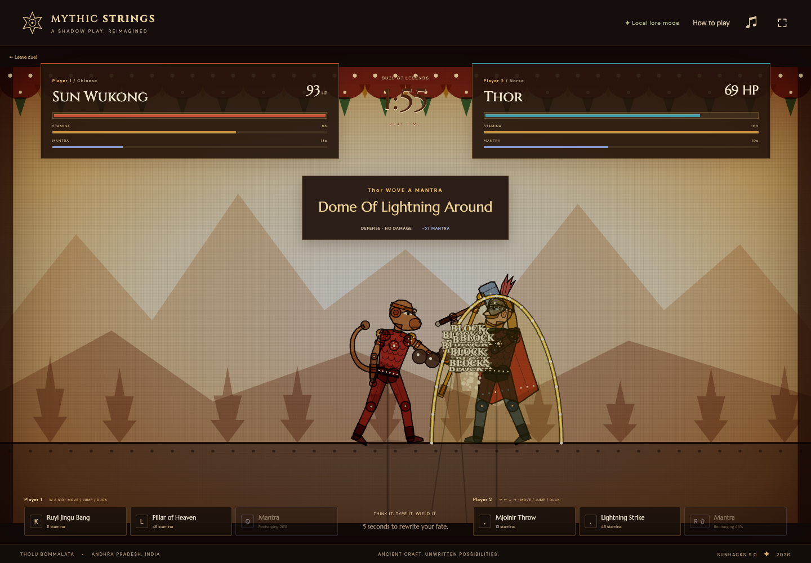
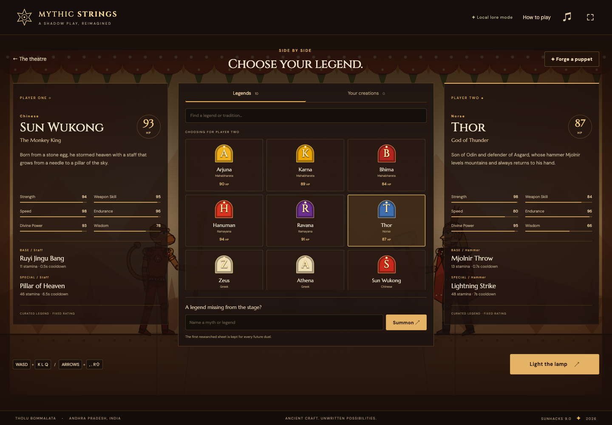
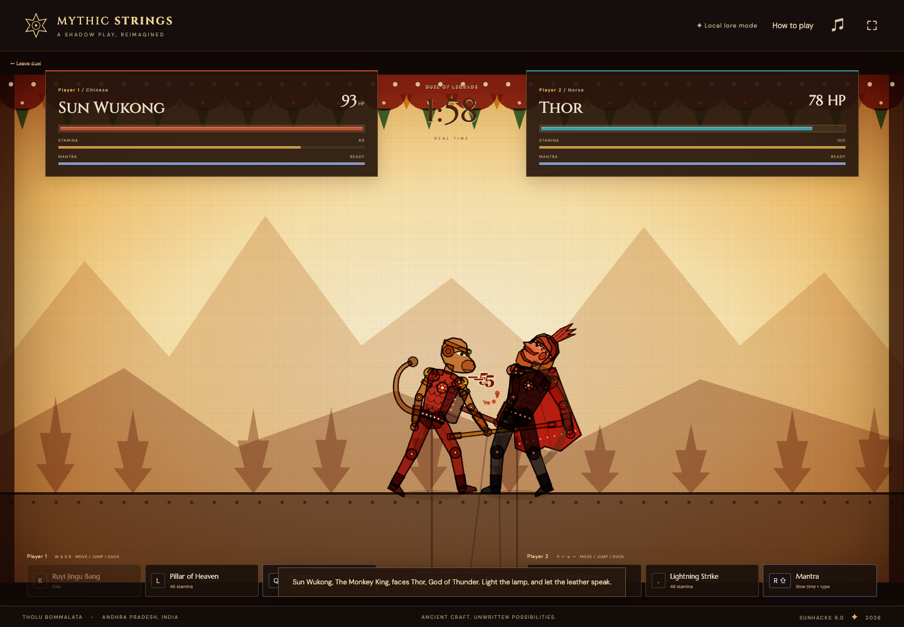
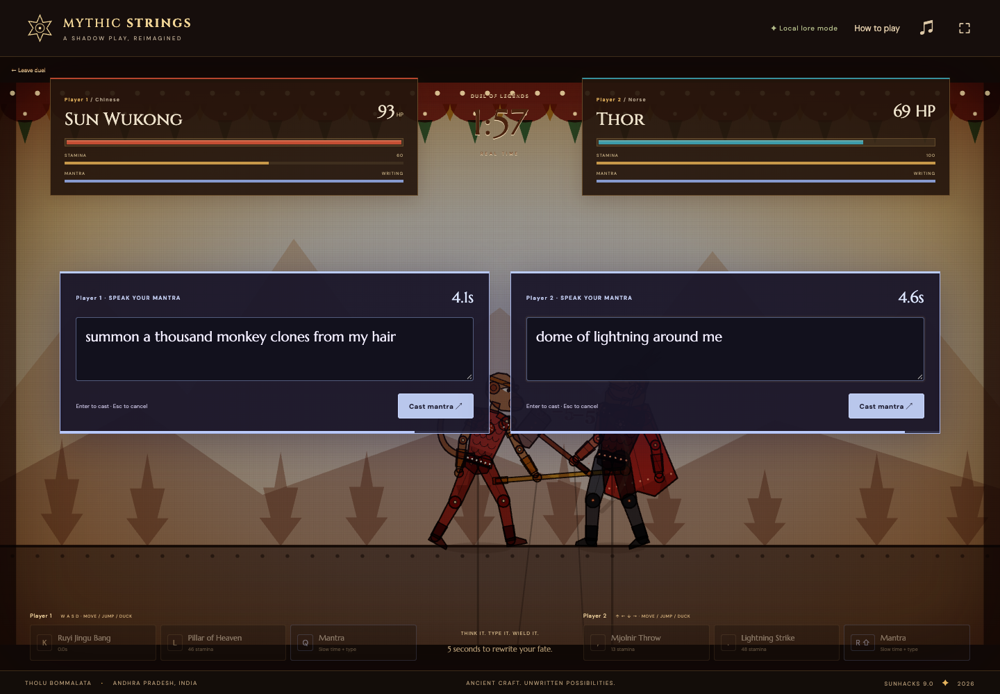
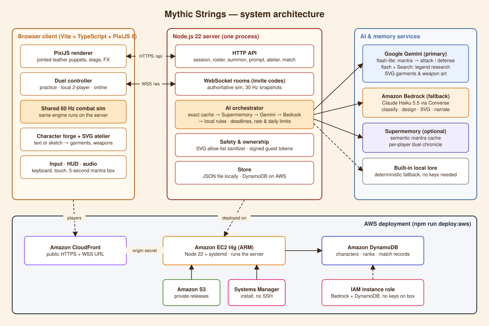

# Mythic Strings

**A real-time duel of legends, staged as a Tholu Bommalata leather shadow play, where you fight with your imagination as well as your reflexes.**



## The problem

Traditional fighting games are repetitive. Every character ships with a fixed move list, every match collapses into the same handful of memorised combos, and once you have seen a fighter's moves you have seen everything they will ever do. Creativity stops at the character-select screen.

## Our solution

Mythic Strings keeps the speed of a real-time fighter but lets you **type any attack or defense into existence mid-fight**:

- **Mantras:** press Q and the arena slows to 12% speed for five real seconds. Type anything, such as *"summon a thousand monkey clones from my hair"* or *"dome of lightning around me"*. AI turns your words into a real, balanced move with its own shape, damage and blocking, so no two duels play out the same.
- **Any legend you can name:** ten curated fighters (Sun Wukong, Thor and more), or summon any other figure by name. AI researches them with cited sources and builds a fair stat sheet from six criteria.
- **Forge your own puppet:** design clothing and weapons from a text description or a hand-drawn sketch, then rank your character up through real wins.
- **Play anywhere:** practice against the CPU, play local two-player on one keyboard, or play online through invite codes on an authoritative server.
- **A living art form:** every fighter is a jointed, translucent leather puppet inspired by Tholu Bommalata, the shadow-puppet tradition of Andhra Pradesh, India.

Fairness is built into the rules engine rather than left to the AI. Damage budgets, stamina, cooldowns, two-second effect caps and wall/canopy/dome blocking all apply, and the full game still works with no AI keys through a built-in local interpreter.

## Screenshots: Sun Wukong vs Thor

| Choose your legends | Trading blows in real time |
| --- | --- |
|  |  |
| **Both players type mantras at the same time** | **Home: the shadow theatre** |
|  |  |

## Architecture



The editable draw.io source is [docs/architecture.drawio](docs/architecture.drawio): open it at [app.diagrams.net](https://app.diagrams.net) or in the draw.io desktop app.

- **One deterministic 60 Hz combat engine** (`src/shared`) runs in the browser for local play and on the server for online play. Online clients send only inputs and text, never HP or damage.
- **AI orchestrator:** checks an exact cache, then Supermemory semantic memory, then Gemini, then Amazon Bedrock (Claude Haiku 5.5), and finally a deterministic local interpreter, all under per-request deadlines and rate and daily limits.
- **Generated SVG art** is rebuilt through a strict element and attribute allow-list before it is rendered.
- **Deployment:** a single Node process serves the client, the REST API and WebSockets. On AWS it runs on EC2 behind CloudFront (HTTPS + WSS), stores data in DynamoDB, and is installed through S3 and Systems Manager.

## Run locally

Use Node.js 22 or newer.

```sh
npm ci
cp .env.example .env
npm run dev
```

Open **http://127.0.0.1:5173**. The API and WebSocket server runs on port 8787. A placeholder-only `.env` is already supplied in this workspace; keep it if you have started editing it.

The complete game works without cloud keys: ten curated legends, the character forge, locally cut SVG patterns, deterministic prompt interpretation, local duels, practice, online invite rooms, and file persistence. The status badge identifies local lore mode.

## Play

| Action | Player 1 / online player | Local player 2 |
| --- | --- | --- |
| Move | A / D | Left / right arrows |
| Jump / duck | W / S | Up / down arrows |
| Base attack | K | Comma |
| Special attack | L | Period |
| Open mantra | Q | Right Shift |
| Cast / cancel while typing | Enter / Escape | Enter / Escape in the focused field |

Online players can also move with arrow keys. Buttons work with a mouse or touch. **Enter the theatre** starts practice; **Local duel** uses two seats on one machine; **Play online** creates or joins an invite-code room.

Two attached keyboards work as one browser keyboard. Browsers cannot attribute ordinary keystrokes to separate physical keyboards; on one machine, text goes to the focused mantra box. Both mantra windows can be open together. Online players type independently on their own devices.

## Battle rules

- Two real minutes of combat, with a three-second introduction. Slow motion affects the arena, while the match clock keeps running normally.
- Zero HP ends the duel. At time, the fighter with more remaining HP wins; equal HP draws.
- Every puppet has exactly one base and one special attack tied to its equipped weapon. Both consume regenerating stamina and have cooldowns.
- A mantra slows both fighters' world to 12% speed and allows five real seconds to type, with at most 80 characters. It consumes a separate mantra bar, then locks until that bar refills completely.
- Mantras are exclusively attacks or defenses. Defenses deal zero damage. A wall blocks side attacks, a canopy blocks overhead attacks, and a dome blocks both.
- Effects last at most two **arena** seconds. Poison and other lingering attacks split their fixed damage budget 50% / 25% / 25%, with two arena seconds between ticks.
- Legends keep fixed ratings from six criteria: strength, weapon skill, speed, endurance, divine power, and wisdom. Their rating sets starting HP.
- Custom characters start at 60 HP, reach a new rank every three human wins, and cap at rank 10 / 100 HP. Practice does not award progression.

## Add AI

Edit `.env`; restart the server after changing it. Every setting is documented in [.env.example](.env.example). No secret belongs in a `VITE_*` variable.

| Service | Configuration | Used for |
| --- | --- | --- |
| Gemini | `GEMINI_API_KEY` | Fast prompt classification; researched legends with Google Search citations; SVG garments and weapon art from text/sketches; narration |
| Amazon Bedrock | `BEDROCK_ENABLED=true`, AWS credentials locally or the EC2 instance role | Fallback classification, character design, SVG art, narration |
| Supermemory | `SUPERMEMORY_API_KEY` | Optional semantic cache and per-player duel chronicle |
| DynamoDB | `DYNAMODB_TABLE`, `AWS_REGION` | Durable characters, progression, and match records; configured automatically by AWS deployment |

Defaults verified against the official documentation on November 15, 2026: Gemini `gemini-3.5-flash-lite` / `gemini-3.8-flash` through Interactions, Bedrock `us.anthropic.claude-haiku-5-5` through Converse, and the namespace-scoped Supermemory v5 API. See the [documentation references](docs/IMPLEMENTATION.md#documentation-checked).

**Credit eligibility matters:** the direct Gemini Developer API used here does not accept newer Google Cloud Welcome/free-trial credits. Do not assume the $300 GCP credit covers this integration; use an eligible Gemini billing plan or the AWS adapter after checking your AWS promotion's coverage. Google's [billing documentation](https://aistudio.google.com/docs/billing#cloud-credits) explains the distinction. A Vertex AI/Gemini-platform integration is not included.

Built-in characters use curated, fixed sheets. Additional names use researched AI sheets when a provider answers, or an explicitly labelled local interpretation when it does not. Generated SVG is rebuilt through a strict element/attribute allow-list before rendering. Sketch interpretation requires a working multimodal model; local patterns do not interpret an uploaded sketch.

## Production build and checks

```sh
npm test
npm run build
npm start
npm run doctor -- --url http://127.0.0.1:8787 --online
```

The production Node process serves the built client, API, and WebSockets from one origin.

```sh
# Uses installed Google Chrome on macOS.
# On Linux, install the Playwright browser once: npx playwright install chromium
npm run test:e2e
```

The browser suite starts an isolated temporary server, explicitly disables paid providers, tests a real knockout, checks two-browser online play, and saves desktop/mobile screenshots to `artifacts/`. Tests never use your character store.

The doctor checks static serving, the roster, and health. `--online` also tests a two-seat WebSocket invite. `--ai` tests prompt resolution and requires an AI/cache result; it can consume provider credits.

## Deploy to AWS

```sh
# Configure your normal AWS CLI identity first, then fill the desired .env keys.
npm run deploy:aws
```

The deployer builds and tests locally, uploads a private encrypted release and environment file, and creates EC2 + DynamoDB + a public HTTPS CloudFront URL. It installs the release through Systems Manager and confirms public health before printing the URL.

It does not require local Docker or SSH keys. It creates billable AWS resources only when **you run the deployment command**. See [the AWS runbook](docs/DEPLOYMENT.md) for permissions, VPC requirements, costs, updates, troubleshooting, and teardown.

## Layout

```text
src/shared/         deterministic combat, balance, roster, moves, normalization, wire protocol
src/client/         screens, forge, keyboard/touch input, HUD, local/remote duel controllers
src/client/render/  jointed leather puppets, stage, effects, particles and damage numbers
src/server/         HTTP API, guest ownership, authoritative rooms, provider adapters, stores
infra/aws/          CloudFormation, deploy/update/bootstrap/teardown scripts
scripts/            environment helpers, isolated test server, deployment doctor
tests/              rules, provider boundaries, persistence, browser/API integration tests
legacy/poc-v1/      preserved turn-based proof of concept
```

The original continuation plan and remaining credential-dependent checks are recorded in [docs/IMPLEMENTATION.md](docs/IMPLEMENTATION.md).
